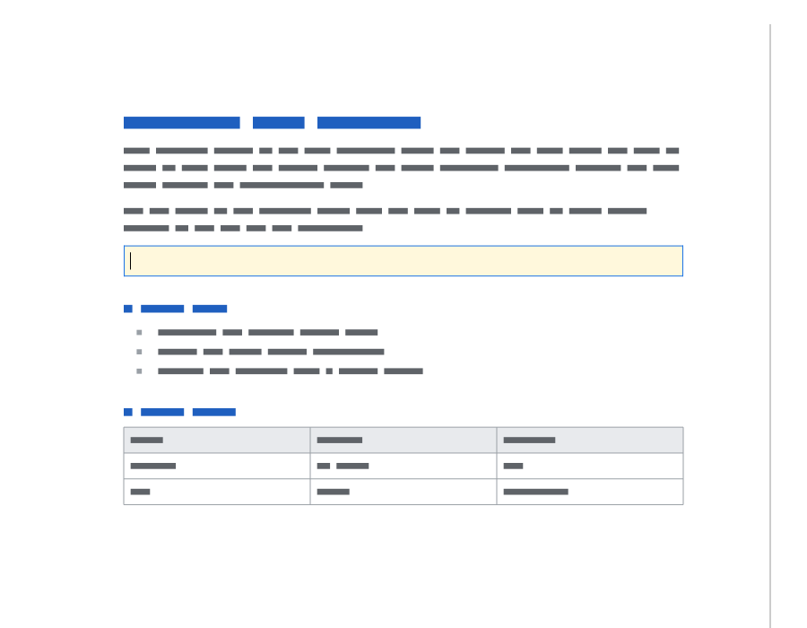
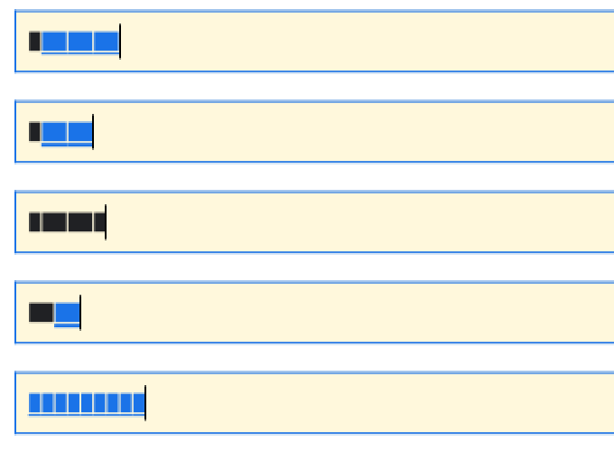

# DESK-002 report: the document canvas, input methods and accessibility

| | |
|---|---|
| Work package | [DESK-002](https://github.com/BayanDocs/docs/blob/HEAD/workpackages/phase-0/DESK-002-spike-qt-canvas.md), the validation gate of [ADR-0013](https://github.com/BayanDocs/docs/blob/HEAD/adr/0013-desktop-shell.md) |
| Date | 2026-10-12 |
| Engine | bayan-core [`664c999`](https://github.com/BayanDocs/bayan-core/commit/664c9992fc6626d61a3818164ada5e0ccf7d9050), CORE-007's engine skeleton with its mock document (pinned in `deps/bayan-core.json`) |
| Qt | 6.12.0, LGPL modules only |
| Manual tests | [DESK-002-manual-tests.md](DESK-002-manual-tests.md): the scripts for the owner, with tables for the results |

## Summary

The desktop app now shows the engine's pages through a document canvas of its own: it asks the engine for square tiles of the pages, keeps them as textures on the graphics card, scrolls and zooms by moving and stretching those textures, and draws the caret and the selection on top. Keys, mouse clicks and the composition of East Asian input methods go to the engine as protocol messages, and the input method learns where the caret is and which text surrounds it. Screen readers see the document as one multi-line text that they can read by character, word and line, follow the caret through, and edit through. The shell decides nothing about the document: every pixel, every caret position and the meaning of every key are the engine's.

Everything was tested automatically against the real engine of bayan-core (CORE-007's mock document) and against the stub engine, at 100 %, 125 %, 150 % and 200 % scaling, including Japanese, Chinese and Korean composition replayed the way each platform's input method sends it, and the accessibility interface as the platform bridges call it. CI now builds bayan-core's C SDK from a pinned commit and runs the same tests on Linux, macOS and Windows. Qt's input-method and accessibility interfaces could express everything the engine offers, so there is nothing to escalate about ADR-0013. The gaps found are in engine protocol v0 (section 6), with proposals.

What a computer cannot test for itself is still open: typing with the real Japanese, Chinese and Korean input methods of Windows and macOS (AC-2), NVDA or Narrator and VoiceOver reading the document (AC-3), and frame times on the reference laptops (AC-1). [DESK-002-manual-tests.md](DESK-002-manual-tests.md) has a script for each, written so the owner can follow it step by step. The measurements made here, on a cloud computer without a graphics card, are encouraging: scrolling and zooming held 60 frames per second at 100 % even with the graphics card emulated by the processor (section 5).

## 1. What was built

```text
 QML: DocumentArea.qml (scroll bars, pinch)              screen readers (UI Automation, NSAccessibility, AT-SPI)
        │                                                          │
 DocumentCanvas (QQuickItem) ───── CanvasAccessible ───── AccessibleText
   ├── ViewGeometry, TileGrid      where pages and tiles go, on whole device pixels
   ├── TileCache                   which tiles exist and whether they are still up to date; memory budget
   ├── TileRenderer                the tile thread, which asks the engine for tiles
   ├── CanvasNode                  the tiles as scene-graph textures, page backgrounds, caret and selection
   ├── KeyMapping, ImeTranslator   keys and input-method events as protocol messages
   └── DocumentSession             the conversation with the engine: pages, overlays, accessibility tree, input
         └── Engine                the C interface (bayan_ffi.h) of the stub or of bayan-core's C SDK
```

| Code | What it does |
|---|---|
| `src/engine/protocol.{h,cpp}` | The protocol's data as C++ values (pages, rectangles, overlays, the accessibility tree, input), with strict parsers: every value from the engine is checked for shape and range, and a malformed message is refused as a whole. The accessibility tree is kept flat (nodes by identifier, children as lists of identifiers) and every walk over it is a loop, so a deep tree cannot exhaust the stack. |
| `src/app/documentsession.{h,cpp}` | The conversation with the engine for one document: handshake, `doc.open`, `view.set`, `query.a11y`, and the input messages. It knows which request caused each event (the engine answers a request before sending the events its handling caused), which the tile cache needs. |
| `src/canvas/tilegrid`, `viewgeometry` | Arithmetic only: the tiles of a page at a scale, where pages and tiles appear, and how points convert between the canvas and the engine's coordinates. |
| `src/canvas/tilecache` | The tiles the canvas has, whether each is still current, failed attempts, and the memory budget (least recently used tiles go first). |
| `src/canvas/tilerenderer` | One thread that renders tiles through the engine's synchronous `bayan_render_tile`, visible tiles first. |
| `src/canvas/canvasnode` | The canvas's part of Qt Quick's scene graph, on the render thread: one texture per tile, uploaded once and then only moved. |
| `src/canvas/documentcanvas` | The Qt Quick item: plans each frame (which tiles to show, render, stretch), scrolling, zooming, keys, mouse, wheel, input methods, the caret's blinking, and reporting changes to screen readers. |
| `src/canvas/keymapping`, `imetranslator` | Qt's key and input-method events as the protocol's DOM-style key values and composition messages. Pure logic, unit-tested with the event sequences each platform sends. |
| `src/a11y/accessibletext`, `canvasaccessible` | The document's text for screen readers, and the accessible interface that Qt's platform bridges ask (installed with `QAccessible::installFactory`). |
| `src/app/benchmark`, `pixelprobe`, `smoketest` | The measurement mode (`bayan-desktop --benchmark <file>`), the check that the window shows exactly the engine's pixels, and the smoke test. |
| `scripts/build-engine-sdk.sh` | Builds bayan-core's C SDK from the commit pinned in `deps/bayan-core.json`, for CI and for developers. |

## 2. How the canvas draws

- **Tiles.** Each page is cut into square tiles of 512 device pixels (`--tile-size` changes it, from 64 to 2,048) at one scale: the zoom times the screen's device pixel ratio. A tile's edges are the page coordinates of whole pixels, `round(pixel × 19,050 / scale)` BLU, so two neighbouring tiles share their edge exactly and nothing shows a seam; a unit test checks this at scales from 0.1 to 10.
- **Sharp at fractional scaling.** Pages and tiles are placed on whole device pixels of the window (the canvas's own position in the window included), so at 125 % on Windows or 200 % on a Retina screen a tile is copied to the screen pixel for pixel. The tests check it directly: at nine points of a page they ask the engine to render that single device pixel and compare it with what the window shows. CI runs them at 100 % and 125 %; for this report they also ran at 150 % and 200 %, and the smoke test at 175 % and 300 %, against both engines. All match.
- **Up to date without flicker.** Each tile remembers the last request the engine had handled when it rendered the tile, and each `render.invalidate` the request that caused it. A tile rendered before a change that touches it is marked out of date, stays on screen, and is rendered again; when the new one arrives it replaces the old texture in place.
- **Zoom.** While the zoom changes (pinch, Control with the wheel, Control with plus or minus), the canvas stretches the tiles it has; 150 ms after the zoom stops it tells the engine the new view and asks for tiles at the new scale, showing the stretched ones until they arrive. When it still holds tiles of several earlier zooms, it takes them from the closest zoom first, and from a farther one only where the closer one has none, and draws the closest on top, because it is the sharpest. Zooming keeps the point under the pointer still.
- **Frame budget.** At most 8 new textures are uploaded per frame; the rest follow in the next frames. Tiles half a screen above and below the view are rendered ahead, so scrolling finds them ready.
- **Memory.** The cache keeps tiles within a budget (128 MiB by default; section 5 recommends a smaller one) and drops the least recently shown first, never one the current frame shows.

## 3. Keys and input methods

- **Keys** go to the engine as `input.key` with the DOM's key and code values and modifiers, and the text a key types as `input.text`. On macOS, Qt reports Command as Control; the canvas swaps them back, so the engine sees Command as the DOM's `meta`, as the web app will send it. On Windows, AltGr arrives as Control+Alt and still types. Tab leaves the canvas, so keyboard users are never trapped in the document (ADR-0020). Page Up, Page Down, Control+Home and Control+End scroll and Control with plus, minus or 0 zooms; these view keys stay in the shell until the engine moves the caret through documents.
- **Input methods.** `inputMethodQuery` answers with the engine's caret (from `overlay.update`, so the candidate window opens next to it), the text of the editable node that holds the accessibility caret and the caret's offset in it, and whether text can be typed there. `inputMethodEvent` becomes `input.composition` start, update (with the clause being converted as the selection, which Windows and macOS mark with a background colour) and end, and the committed text becomes `input.text`. While a composition runs, the input method keeps seeing the text from before it started, because the engine's tree already contains the composition.
- **Replacing text near the caret.** macOS's accent menu (hold "e", choose "é"), Japanese reconversion and IBus's "delete surrounding text" replace text before or after the caret. Protocol v0 has no message for that, so the canvas sends Backspace and Delete keys, counted in characters, followed by the new text. The input method decides how far the range reaches, so the canvas deletes no more than the editable text around the caret holds, and nothing where there is none. It works with the mock document, but it is an emulation (section 6).

## 4. Accessibility

- **One text.** The canvas exposes the document as a single multi-line editable text: the text of every node that has text, in reading order, one node per line. On macOS that is a text area (`AXTextArea`), on Windows an edit control with UI Automation's text pattern, on Linux AT-SPI's editable text. Screen readers then offer their usual reading by character, word, line and paragraph. The interface reports where every character is on the screen, from the engine's character boxes, and raises text-changed and caret-moved events when the engine's tree changes, so typing is echoed.
- **Reading the whole document.** The mock document's caret never leaves the editable line, and the arrow keys go to the engine, so they move only within that line; screen readers read the rest with their own reading commands (NVDA's review cursor, VoiceOver's read-all). Reading by moving the caret needs a document whose caret goes everywhere, and protocol finding 5.
- **Editing through accessibility** (dictation, braille input) inserts at the caret with `input.text` and deletes next to the caret with Backspace and Delete; anything else is refused, because protocol v0 edits only at the caret.
- **Left out because protocol v0 cannot answer**: selections, moving the caret to an offset (a screen reader's "move to this word"), finding the character under a point (that is hit-testing, which belongs to the engine) and text attributes (fonts, styles, language).
- **Why one text and not a tree of objects.** A tree (one accessible object per paragraph, heading, list item and table cell) would let screen readers jump by heading and navigate tables by cell, but macOS gives document-type roles no text value, and the engine's v0 tree does not yet have the line and selection information a per-paragraph tree needs. The single text works with every screen reader now; DESK-103 should revisit it once the protocol has the additions of section 6.

## 5. Measurements

### What was measured, and how far it goes

`bayan-desktop --benchmark <file>` drives the canvas through a fixed script and writes JSON: scrolling from the top of the mock document to the bottom and back (6 s), zooming 100 % → 200 % → 50 % → 100 % (1.5 s each, a pause after each), and typing 40 keys into the editable line. For scrolling and zooming it records the interval between the frames the window presented while the view was moving; a frame is late if it took more than 1.5 times the screen's refresh interval. For typing it records keystroke to pixel: from the key press to the first frame that shows the engine's new pixels.

These figures come from a cloud computer without a graphics card (4-core Intel Xeon at 2.1 GHz, Ubuntu 24.04, window 1,190 × 725 points). Two renderers were used: Qt Quick's software renderer (no screen refresh, so frames come as fast as the processor allows) and Qt's OpenGL path on Mesa's llvmpipe under Xvfb, where the processor emulates the graphics card and frames follow a 60 Hz refresh. They say how the canvas behaves when drawing is slow; AC-1 asks for the reference laptops (a 2020-era mid-range laptop: 4-core x86-64 or Apple M1, 8 GB), which the owner's manual test measures with the same command.

### Scrolling and zooming

Frame intervals while the view moves, in milliseconds (at 60 Hz a frame is due every 16.7 ms and counts as late above 25 ms):

| Run | Scroll: frames | p50 / p95 / p99 / max | late | Zoom: frames | p50 / p95 / p99 / max | late |
|---|---|---|---|---|---|---|
| Software renderer, 100 % | 757 | 5.4 / 13.4 / 17.4 / 29.5 | 2 | 563 | 5.2 / 16.3 / 19.7 / 31.7 | 1 |
| OpenGL (llvmpipe), 100 % | 364 | 15.8 / 18.1 / 21.2 / 22.7 | 0 | 276 | 16.0 / 18.6 / 20.2 / 20.9 | 0 |
| OpenGL (llvmpipe), 125 % | 364 | 15.8 / 18.7 / 21.0 / 42.6 | 2 | 278 | 15.7 / 19.0 / 25.8 / 45.9 | 3 |
| OpenGL (llvmpipe), 200 % | 305 | 20.8 / 24.3 / 27.4 / 30.3 | 9 | 185 | 22.6 / 32.0 / 38.5 / 38.8 | 73 |

At 100 % the canvas kept the refresh rate even with an emulated graphics card, and at 125 % it missed 5 of 642 frames. At 200 % the emulated graphics card has four times as many pixels to fill on every frame and falls to about 45 frames per second; a real graphics card fills that many pixels in a fraction of a millisecond, which the manual test on the reference laptops confirms or refutes. Scrolling through the three pages and back uploaded 30 textures at 100 % for 18 distinct tiles: a tile's texture exists only while the tile is visible, and a tile that scrolls back into view is uploaded again from the cache. No frame in any run showed a hole: every visible area showed either a current tile or a stretched one.

### Typing

| Run | Keystroke to pixel p50 / p95 / p99 (ms) | Keys lost | Tile render p50 / p95 (ms) | Tiles per key | Tile cache (MB) | Peak memory (MB) |
|---|---|---|---|---|---|---|
| Software renderer, 100 % | 13.4 / 15.5 / 19.6 | 0 of 40 | 2.0 / 2.9 | 2.0 | 37.8 | 97.7 |
| OpenGL (llvmpipe), 100 % | 23.9 / 29.1 / 29.5 | 0 of 40 | 2.2 / 6.2 | 2.0 | 37.8 | 231.0 |
| OpenGL (llvmpipe), 125 % | 29.3 / 38.8 / 43.6 | 0 of 40 | 2.2 / 7.9 | 2.0 | 59.1 | 279.0 |
| OpenGL (llvmpipe), 200 % | 76.4 / 85.9 / 87.0 | 0 of 40 | 2.1 / 6.6 | 6.1 | 127.3 | 415.9 |

PERF-04 asks for keystroke to pixel within 16 ms at p95 and 33 ms at p99, a Phase 2 requirement. The software renderer meets it here; with frames paced at 60 Hz a key waits for the next refresh, and at 200 % each key makes the engine render 6 whole tiles of 512 × 512 pixels, one after another, for a change one line high. The peak memory includes llvmpipe's own copies of every texture, which a real graphics card keeps in its own memory.

### What this means

- **AC-1 is promising but not yet shown.** Nothing in the canvas limits the frame rate: at 100 % on llvmpipe, Qt's render-loop timing (`QSG_RENDER_TIMING=1`) showed no frame that took the render thread more than 38 ms, and the slow frames at 200 % come from filling pixels on the processor.
- **Keystroke to pixel needs work before Phase 2** (PERF-04). The biggest cost is re-rendering whole tiles for a one-line change; recommendations 2 and 3 in section 7 address it.
- **Memory needs a smaller tile budget** (PERF-05: 150 MB for a typical document). At 200 % the cache reached its 128 MiB budget; recommendation 4 in section 7 sizes it to the screen instead.

## 6. Findings

### Qt

1. **Qt's software renderer misplaces nodes added later under a plain `QSGNode`.** It remembers positions only for transform, clip and opacity nodes, so children added to a plain node after the first frame were drawn as if the canvas sat at the window's top-left corner (112 pixels too high in the app's window). The canvas uses transform nodes with the identity matrix as its layers (`canvasnode.h` explains it). The OpenGL path is not affected. Worth reporting to Qt with a small reproduction (follow-up).
2. **The offscreen platform's window grabs say their device pixel ratio is 1 at any scale factor**, although they hold device pixels; the pixel check derives the ratio from the grab's size.
3. **A Qt Quick item created with a parent from C++ does not see its first `ItemSceneChange`** in its own `itemChange`, because Qt sends it from `QQuickItem`'s constructor. The canvas then never learnt the window's device pixel ratio and drew stretched tiles of 100 % at 125 %. It now reads the ratio in its constructor; the 125 % tests found this.
4. Qt's input-method and accessibility interfaces could express everything the engine offers, and everything section 6's protocol additions would offer. Nothing here calls for amending ADR-0013.

### Engine protocol v0

Each of these is a proposal for the engine protocol's next version; the shell works around the first three today. Contract-first, they start as a pull request to `specs/engine-protocol.md` (ADR-0002 §2).

1. **Replacing text near the caret.** Input methods replace text before or after the caret (accent menus, reconversion, Korean and Thai editing, IBus's delete-surrounding-text). The shell emulates it with Backspace and Delete keys, which the engine may treat as deleting whole grapheme clusters while the input method counted code units. Proposal: `input.text` gets an optional range to replace, relative to the caret, in UTF-16 code units.
2. **The surrounding text contains the composition.** The editable node's text includes the text being composed, which input methods must not see as surrounding text; the shell freezes the text from before the composition. Proposal: the accessibility caret or the overlay reports the composition's range.
3. **`view.set` invalidates every page**, even when only the viewport moved; the canvas therefore sends it only when the zoom, the device pixel ratio or the canvas's size change, never while scrolling. Proposal: invalidate only when the zoom, scale or view mode change.
4. **No hit-testing query.** Screen readers ask for the character under a point (reading under the mouse, macOS's trackpad commander); `offsetAtPoint` returns "unknown". Proposal: `query.hit_test {page, point} → {node, offset}`.
5. **No way to move the caret to an offset.** Screen readers move the caret when the user navigates by word or line; `setCursorPosition` does nothing. Proposal: `input.set_selection {node, offset, anchor?}`.
6. **No selection in the accessibility data**, so screen readers cannot read the selection. Proposal: selection ranges next to the accessibility caret.
7. **No line ranges in accessibility nodes.** A wrapped paragraph is one line for the screen reader, which reads it whole on "next line". Proposal: the start offset of each visual line in nodes with text.
8. **Events do not say which request caused them.** The shell infers it from the order of replies, which the protocol guarantees but which is easy to break. Proposal: a `cause` field on `render.invalidate`.
9. **Tile rendering and input share the engine's single thread**, so tiles wait behind input and input behind tiles. PERF-04 will need rendering that does not block input, for example rendering from a snapshot on another thread.
10. **DOM `code` values** (the physical key) are sent only for keys whose position does not depend on the keyboard layout, because Qt has no portable scan-code table. If the engine ever needs physical keys for letters, the shell needs a table per platform.

### Process

- CI tests against the real engine built from a pinned bayan-core commit (ADR-0002 §4, Phase 0). The tests that need the mock document skip with the stub engine, and fail instead of skipping in the job that builds the real engine (`BAYAN_REQUIRE_MOCK_DOCUMENT`), so that job cannot pass by skipping.
- The benchmark first counted the pauses between zoom steps as late frames; Qt draws nothing while nothing changes, so it now measures frame intervals only while the view moves.

## 7. Recommendations

1. **Keep ADR-0013's decision.** Qt Quick with a thin C++ canvas expressed everything the engine needs. Confirm AC-1, AC-2 and AC-3 with the manual tests before marking the gate passed.
2. **Render only what changed** (DESK-101, PERF-04): for a small invalidated rectangle, ask the engine for just that rectangle at the tile's scale and patch the tile, instead of rendering the whole 512 × 512 tile; and render tiles that touch the caret first.
3. **Give tile rendering its own path in the engine** (engine protocol, PERF-04): see protocol finding 9.
4. **Size the tile cache to the screen** (PERF-05) instead of a fixed 128 MiB: for example twice the visible area in device pixels (the view and the tiles rendered ahead) for the current zoom, and as much again for one other zoom, which is about 55 MB at 200 % for this window; and drop tiles of zoom levels not shown for a while.
5. **Propose protocol v1 additions** 1 to 8 of section 6 in one contract-first pull request before DESK-101 and DESK-103 need them.
6. **Run the benchmark on the reference laptops in CI's nightly integration job** (X-102) once a self-hosted runner with a real graphics card exists; until then the owner's manual run is the reference.
7. **DESK-103:** revisit the single-text accessibility model once lines, selection and hit-testing exist (section 4).
8. **Report the software renderer's node placement to Qt** (finding 1), with a small reproduction.

## 8. Acceptance criteria

| | Status | Evidence |
|---|---|---|
| AC-1 Scrolling and zooming at the display's refresh rate on reference hardware | **Open:** measured here without a graphics card (section 5); the reference laptops are the owner's manual test | `bayan-desktop --benchmark`; [manual test 1](DESK-002-manual-tests.md) |
| AC-2 Japanese, Chinese and Korean composition in the engine's editable line on Windows and macOS | **Open:** the composition reaches the engine and shows in its editable line when the event sequences of Windows, macOS and IBus are replayed (`tst_canvas`, `tst_input`, screenshots below); the real input methods are the owner's manual test | [manual test 2](DESK-002-manual-tests.md) |
| AC-3 A screen reader reads the mock document on Windows and macOS; Linux reported | **Open:** the accessible interface gives the whole document's text, the caret, character positions and change events as the platform bridges ask for them (`tst_canvas`); NVDA or Narrator, VoiceOver and Orca are the owner's manual test | [manual test 3](DESK-002-manual-tests.md) |
| AC-4 No document logic in the shell | **Met:** the shell places what the engine says where it says; it computes only view arithmetic (zoom, scroll, device pixels) and relays input. The view keys (Page Up and Down, zoom keys) move the view, not the caret. | Code review; `tst_canvas` checks every pixel against the engine |
| AC-5 Report with measurements and recommendations | **Met** | This report |

## 9. Screenshots

Taken by the canvas tests against the real engine (`BAYAN_TEST_SCREENSHOTS=<folder> build/engine-sdk/tests/tst_canvas`). CORE-007's mock engine draws text as grey bars rather than letters, so the pictures show structure: the editable line is the yellow box.

The mock document at 100 %:



The editable line during composition, from top to bottom: Japanese kana being composed after a typed "a" (blue and underlined), the converted clause 日本, the committed text with "b" after it, Korean with the last syllable still composing, and Chinese pinyin before choosing a candidate:



## 10. How to reproduce

```sh
scripts/dev-setup.sh && . ~/.local/share/bayandocs/desktop-tools/env.sh
scripts/build-engine-sdk.sh                                    # bayan-core's C SDK at the pinned commit (needs rustup)
BAYAN_REQUIRE_MOCK_DOCUMENT=1 scripts/test-engine-sdk.sh --sdk build/bayan-core-sdk
QT_QPA_PLATFORM=offscreen build/engine-sdk/src/bayan-desktop --benchmark results.json
xvfb-run -a env QT_QPA_PLATFORM=xcb QSG_RHI_BACKEND=opengl build/engine-sdk/src/bayan-desktop --benchmark results-gl.json
```
